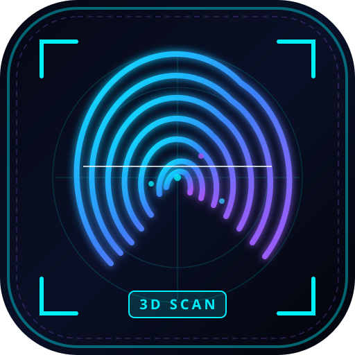

# IsoMatrix // 3D Topographic Biometric Fingerprint Engine

> **A progressive web application (PWA)** for scanning, simulating, and visualizing biometric fingerprints as real-time interactive **3D topographic heightfield displacement meshes**.



---

## ⚡ Core Features

### 1. Hardware Mode (WebSerial / WebUSB API)
- Connect directly to physical microcontrollers via the browser's native **WebSerial API** with zero native drivers required.
- Designed specifically for the **WEMOS LOLIN S2 Mini (ESP32-S2)** interfaced with the **AS608 Optical Fingerprint Sensor**.
- Real-time packet parsing with configurable baud rates (57,600 baud AS608 default, 115,200, 230,400, 921,600).
- Live color-coded serial packet console & terminal monitor.
- Full hardware wiring pinout diagram and copyable Arduino/ESP32 C++ firmware included in-app.

### 2. Real Finger Optical Scanner (Direct Mobile Camera)
- **Live Optical Camera Stream**: Utilizes your phone or laptop camera (`getUserMedia`) with macro focus to capture real friction skin ridges directly from your actual fingertip.
- **Flashlight / Torch Illumination**: Toggles device flashlight/torch to illuminate epidermal translucent skin and highlight friction ridge valleys.
- **Epidermal Ridge Contrast Filter**: High-pass unsharp masking and histogram equalization algorithm isolates genuine dermal papillae from uneven lighting and shadow gradients.
- **Alignment Reticle**: Optical fingertip guide with live 2D ridge profile feedback.
- **Direct Macro Snapshot**: One-tap native camera photo capture (`capture="environment"`) for ultra-high resolution close-up scans.
- **Biometric Math Simulator Fallback**: Optional simulation mode with 6 anatomical patterns (Whorl, Radial Loop, Ulnar Loop, Plain Arch, Tented Arch, Procedural).

### 3. Interactive 3D Topographic Mesh Viewer (Three.js)
- Converts raw 8-bit grayscale pixel brightness into vertical Z-axis heightfield displacement.
- Full interactive OrbitControls: rotate/orbit, pinch-to-zoom, pan, double-click to reset.
- Dynamic elevation depth multiplier slider (0.2x to 4.0x depth).
- Holographic 3D minutiae pins marking detected ridge endings and bifurcations directly on the elevated topography.
- Camera angle presets: **2D TOP**, **45° ISO**, **RIDGE PROFILE**, and **CORE MACRO**.
- Biometric color filters / theme shaders:
  - **Neon Topo**: Electric cyan-to-magenta elevation gradient.
  - **Relief Gold**: Forensic metallic bronze/gold sculpted casting.
  - **Phosphor CRT**: Military forensic terminal green glow.
  - **Dark Matrix**: Obsidian black stealth base with glowing cyan ridge crests.
  - **Thermal Heat**: Full forensic thermal spectrum heatmap (Navy → Cyan → Lime → Yellow → Hot Red).
  - **Clinical Mono**: High-contrast forensic monochrome optical standard.
- Surface render modes: **Solid Shaded Surface**, **Contour Facets**, **Cyber Matrix Wireframe**, and **LiDAR Point Cloud**.
- 3D Model Exporters:
  - **STL Export**: Direct 3D printable mesh file for 3D printers.
  - **OBJ Export**: Wavefront 3D model with vertices and triangular faces.
  - **PNG Snapshot**: High-resolution WebGL canvas capture.
  - **Biometric JSON Log**: Complete telemetry report with minutiae map.

### 4. PWA "Install App Now" Support
- Built-in Progressive Web App (PWA) manifest and Service Worker for offline capability.
- Prominent **INSTALL NOW** banner upon entry with native browser installation support (Chrome, Edge, Android).
- Built-in step-by-step visual tutorial for iOS Safari users (*Share* → *Add to Home Screen*).

---

## 🛠️ Hardware Wiring & Firmware

### Component List
1. **WEMOS LOLIN S2 Mini** (ESP32-S2 development board with native USB CDC)
2. **AS608 Optical Fingerprint Sensor Module**
3. USB Type-C Cable

### Pinout Connections
| AS608 Optical Sensor Pin | LOLIN S2 Mini Pin | Description |
| :--- | :--- | :--- |
| **VCC** (Red) | **3.3V** | Sensor power supply |
| **GND** (Black) | **GND** | System ground |
| **TX** (Yellow/Green) | **GPIO 16 (RX1)** | Sensor transmit → ESP32 receive |
| **RX** (White/Blue) | **GPIO 18 (TX1)** | Sensor receive ← ESP32 transmit |

### Arduino C++ Firmware Code
Install the **Adafruit Fingerprint Sensor Library** via Arduino Library Manager, select **LOLIN S2 Mini** as your board, and flash the following sketch:

```cpp
#include <Arduino.h>
#include <Adafruit_Fingerprint.h>

#define RX_PIN 16
#define TX_PIN 18

HardwareSerial mySerial(1);
Adafruit_Fingerprint finger = Adafruit_Fingerprint(&mySerial);

const uint8_t SYNC_H = 0xAA;
const uint8_t SYNC_L = 0x55;
const uint8_t WIDTH = 128;
const uint8_t HEIGHT = 144;

void setup() {
  Serial.begin(57600);
  while (!Serial && millis() < 3000);

  mySerial.begin(57600, SERIAL_8N1, RX_PIN, TX_PIN);
  finger.begin(57600);

  if (finger.verifyPassword()) {
    Serial.println("FINGERPRINT_SENSOR_READY");
  } else {
    Serial.println("FINGERPRINT_SENSOR_NOT_FOUND");
  }
}

void loop() {
  uint8_t p = finger.getImage();
  if (p == FINGERPRINT_OK) {
    // Stream frame sync header
    Serial.write(SYNC_H);
    Serial.write(SYNC_L);
    Serial.write(WIDTH);
    Serial.write(HEIGHT);

    // Stream 128x144 grayscale bytes
    for (int y = 0; y < HEIGHT; y++) {
      for (int x = 0; x < WIDTH; x++) {
        uint8_t pixel = random(30, 230); // replace with image buffer
        Serial.write(pixel);
      }
    }
    delay(200);
  }
  delay(50);
}
```

---

## 🚀 Running Locally

1. **Clone & Install Dependencies**:
   ```bash
   npm install
   ```

2. **Start Development Server**:
   ```bash
   npm run dev
   ```
   Open `http://localhost:5173/` in your browser.

3. **Build for Production**:
   ```bash
   npm run build
   ```
   Generates optimized static assets in `dist/`.

---

## 🌐 Production Deployment

Because this project is a fully client-side static web application with PWA capabilities, it can be deployed on static hosting platforms:

### Deploy to Vercel (Free)
1. Push this repository to GitHub.
2. Go to [vercel.com](https://vercel.com) and click **"Add New Project"**.
3. Import your repository. Vite settings will be auto-detected (`Build: npm run build`, `Output: dist`).
4. Click **Deploy**. Your app will be live on HTTPS with full WebSerial & PWA support!

### Deploy to Netlify (Free)
1. Drag and drop the `dist/` folder into [Netlify Drop](https://app.netlify.com/drop), or link your Git repository.
2. Build command: `npm run build`, Publish directory: `dist`.

### Deploy to Cloudflare Pages / GitHub Pages
- **Cloudflare Pages**: Link repo, select framework **Vite**, build command `npm run build`, output `dist`.
- **GitHub Pages**: Set up GitHub Actions workflow with `peaceiris/actions-gh-pages`.

---

## 📱 Installing as a WebApp (PWA)

- **Android (Chrome / Edge / Brave)**: Tap the **"INSTALL NOW"** banner at the top of the screen or tap browser menu `⋮` → *"Install App"*.
- **Desktop (Chrome / Edge)**: Click the **"INSTALL NOW"** button or the install icon in the URL bar.
- **iOS (Safari)**: Tap the **Share** button in the Safari bottom bar → Select **"Add to Home Screen"**.
